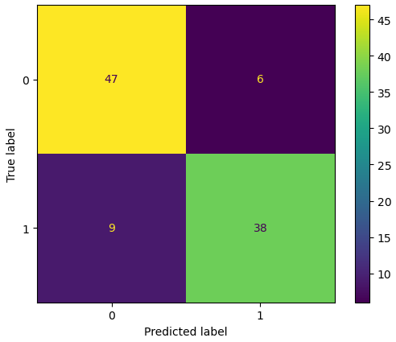

# Matrice Confusion

La matrice de confusion est utilisé en classification pour visualiser ce que le modèle a bien prédit et ce qu'il à mal prédit.

Il s'agit donc d'évaluer le nombre de bonnes et mauvaises réponses du modèle après prédictions d'une classification.


La matrice est un tableau de `n*n` cases où `n` représente le nombre de catégorie d'une cible. Par exemple binaire : "Spam / Pas Spam" mais aussi multi label : "plusieurs matrices binaires" ou multi classes : "Chien / Chat / Renard".

Les valeurs de la matrice correspond au nombre de valeurs correspondantes aux catégories.


|                     | Le modèle prédit :          | Exemple:                          |
| ------------------- | --------------------------- | --------------------------------- |
| TP — True Positive  | positif, et c’était vrai    | spam détecté correctement         |
| TN — True Negative  | négatif, et c’était vrai.   | email normal correctement détecté |
| FP — False Positive | positif, mais c’était faux. | email normal classé spam          |
| FN — False Negative | négatif, mais c’était faux. | spam non détecté                  |

**La matrice se présente ainsi:**

```python
from sklearn.metrics import (
    accuracy_score,
    confusion_matrix,
    classification_report
)

cm = confusion_matrix(y_test, predictions)

print(cm)
```


|              | Négatif | Positif |
| ------------ | ------- | ------- |
| Réel Négatif | TN      | FP      |
| Réel Positif | FN      | TP      |

**Visualisation:**

```python
import matplotlib.pyplot as plt
from sklearn.metrics import ConfusionMatrixDisplay

ConfusionMatrixDisplay.from_predictions(
    y_test,
    predictions
)

plt.show()
```



**Une matrice multi classe à 3 catégories se présente ainsi:**

|              | Class A | Class B | Class C |
| ------------ | ------- | ------- | ------- |
| Réel Class A | 5       | 1       | 0       |
| Réel Class B | 2       | 4       | 1       |
| Réel Class C | 0       | 1       | 3       |

Chaque classe peut être transformé en matrice binaire, ex: Class A

| Class A      | Négatif                    | Positif               |
| ------------ | -------------------------- | --------------------- |
| Réel Négatif | TN = 4 + 1 + 1 + 3 (reste) | FP = 2 + 0 (vertical) |
| Réel Positif | FN = 1 + 0 (horizontal)    | TP = 5                |

**La matrice permet de calculer:**

|           | Répond à ?                                                   | Exemple                                                      |
| --------- | ------------------------------------------------------------ | ------------------------------------------------------------ |
| Accuracy  | Proportion de bonnes réponses                                | (95 + 90) / 200)  = 0.925 = 92.5% correct                    |
| Precision | Quand le modèle dit “positif”, a-t-il raison ?               | 95 / (95 + 10)  = 0.90 = 90% des spams détectés étaient réels |
| Recall    | Parmi tous les vrais positifs, combien ont été trouvés ?     | 95 / (95 + 5) = 0.95 = 95% des spams ont été détectés        |
| F1-score  | Est-ce que mon modèle est équilibré ? (combine précision et recall) | 2 x ((Precision x Recall) / (Precision + Recall)) = 0 mauvais à 1 parfait |


# Exemple numérique

|              | NonSpam | Spam |
| ------------ | ------- | ---- |
| Réel NonSpam | 90      | 10   |
| Réel Spam    | 5       | 95   |

**Interprétation**

* TN => 90 emails normaux correctement détectés.

* FP => 10 emails normaux classés à tort comme spam.

* FN => 5 spams non détectés.

* TP => 95 spams détectés correctement.
