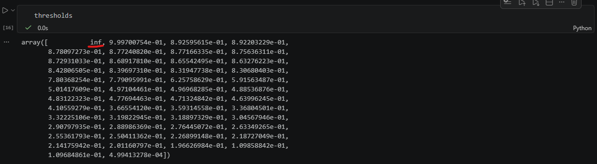
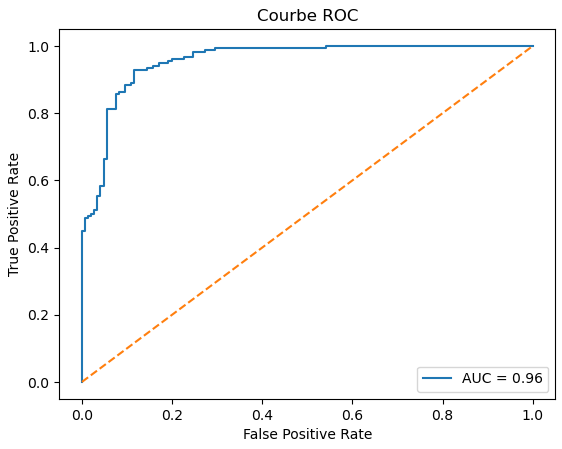

# ROC "Receiver Operating Characteristic"

Cette méthode de calcule est utilisé pour évaluer la performance d'un modèle de [régression classification](RegressionLogistique.md).

> La courbe ROC est une méthode d’évaluation utilisée principalement pour les modèles de **classification binaire**.

Elle permet de mesurer la capacité d’un modèle à :

- détecter les vrais positifs,
- tout en évitant les faux positifs.

Par exemple **si la cible est une valeur foncière en €** alors le résultat sera **l'écart type moyen de la valeur foncière en %**. Ex: +/- 2% de la valeur cible


Le MAPE répond à :

> “De combien de % mon modèle se trompe-t-il en moyenne ?”


Exemple:

| Prédit    | Attendu   | Erreur |
| --------- | --------- | ------ |
| 200.000 € | 210.000 € | 5 %    |
| 120.000 € | 122.000 € | 1.6 %  |
| 90.000 €  | 90.500 €  | 0.55 % |

Résultat: (5 + 1.6 + 0.55) / 3 = **7.15 %** = MAPE


Vous pouvez également utiliser [MAE](MAE.md) pour rapporter le résultat à un quantitatif en **€**

# Quand l'utiliser ?

MAPE s'utilise en Régression Linéaire et en complément d'autres méthodes d'évaluation tel que [R2](R2.md), [MSE](MSE.md) / [MAE](MAE.md) et [RMSE](RMSE.md).

Il permet d'obtenir une mesure d'erreur relative à un pourcentage.

# Exemple

```python
# .... Création du modèle et du jeu de test ....

from sklearn.metrics import mean_absolute_percentage_error

# Probabilités
y_proba = model.predict_proba(X_test)[:, 1]

# ROC
fpr, tpr, thresholds = roc_curve(y_test, y_proba)

# AUC
auc = roc_auc_score(y_test, y_proba)

print("AUC :", auc)
```

Résultat:

```
AUC : 0.9560131649172745
```

Cela signifie approximativement :

> le modèle a 95% de chances de donner un score plus élevé à un vrai positif qu’à un vrai négatif.

## Explication

**thresholds** : Ce sont les seuils utilisés pour transformer une probabilité en classe

```python
thresholds = [0.95, 0.80, 0.60, 0.40, 0.10]
# Le modèle produit des probabilités :
# > seuil alors Positif
# <= seuil alors Negatif
```

**TPR** : *True Positive Rate*, parmi les vrais positifs, combien ont été trouvés.

```
Supposons :
- 100 vrais spams
- le modèle détecte 90 spams

Alors :
    
TPR = 90 / 100 = 0.90
```

**FPR** : *False Positive Rate*, parmi les vrais négatifs, combien ont été classés à tort comme positifs.

```
Supposons :
- 100 emails normaux
- 15 classés à tort comme spam

Alors :

FPR = 15 / 100 = 0.15
```

**auc** : Valeur de l'air sous la courbe ROC (entre 0 et 1) 

```
AUC	Qualité
0.5	        hasard
0.6 - 0.7	faible
0.7 - 0.8	correct
0.8 - 0.9	bon
0.9 - 1.0	excellent
```

## Comment ça fonctionne ?

Imaginons que `X_test` contient **300 échantillons**

On utilise le modèle pour prédire les probabilités de classification de chaque échantillon:

```
y_proba = model.predict_proba(X_test)[:, 1]
```

`y_proba` contient **300 probabilités** (1 par échantillon)

```
[0.95, 0.81, 0.81, 0.77, 0.62, 0.62, 0.15, ...]
```

`roc_curve` va permettre de trier les probabilités

```
fpr, tpr, thresholds = roc_curve(y_test, y_proba)
```

1. trie les probabilités,
2. prend les valeurs uniques,
3. utilise ces valeurs comme seuils,
4. calcule TPR/FPR pour chaque seuil.

```
# Supposons :

y_proba = [
    0.9,
    0.9,
    0.8,
    0.8,
    0.8,
    0.3,
    0.1
]

# sur 7 échantillons seuelemnt 4 seuils sont utiles :

[0.9, 0.8, 0.3, 0.1]

```

> Scikit-Learn ajoute aussi **un seuil spécial au début** : `inf` pour représenter "aucune prédiction positive"



## Représentation graphique

```python
import matplotlib.pyplot as plt

plt.plot(fpr, tpr, label=f"AUC = {auc:.2f}")

# Diagonale hasard
plt.plot([0, 1], [0, 1], linestyle='--')

plt.xlabel("False Positive Rate")
plt.ylabel("True Positive Rate")
plt.title("Courbe ROC")

plt.legend()

plt.show()
```



Chaque seuil donne un couple :

```
(seuil) → (FPR, TPR)
```

Donc la courbe montre :

> comment le gain augmente quand le coût augmente

### Modèle A

- monte vite vers le haut gauche → bon

### Modèle B

- proche diagonale → hasard
