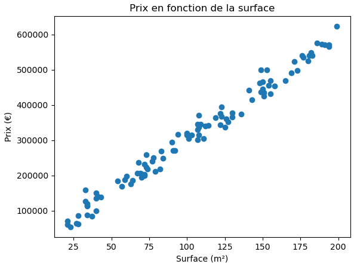
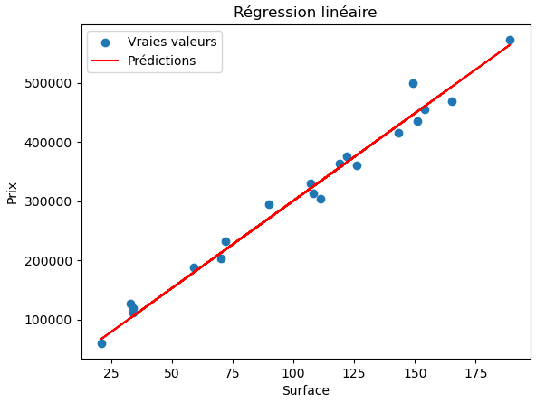
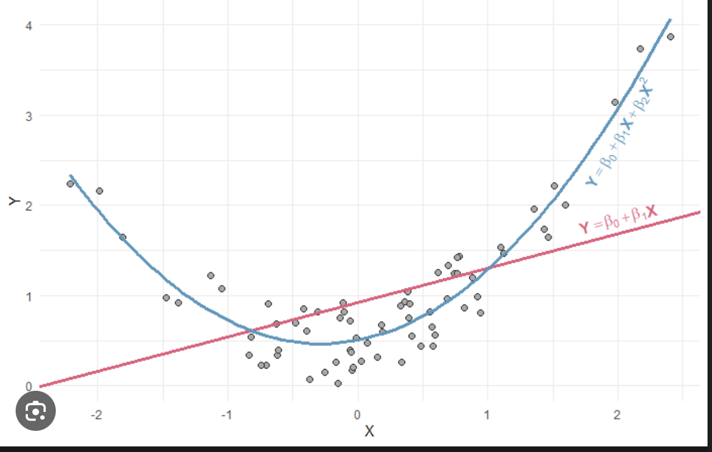
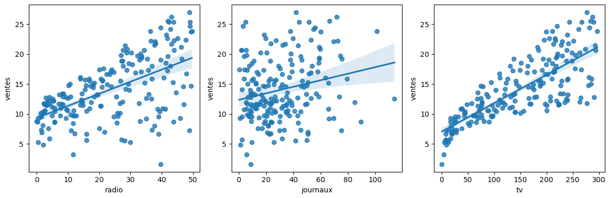
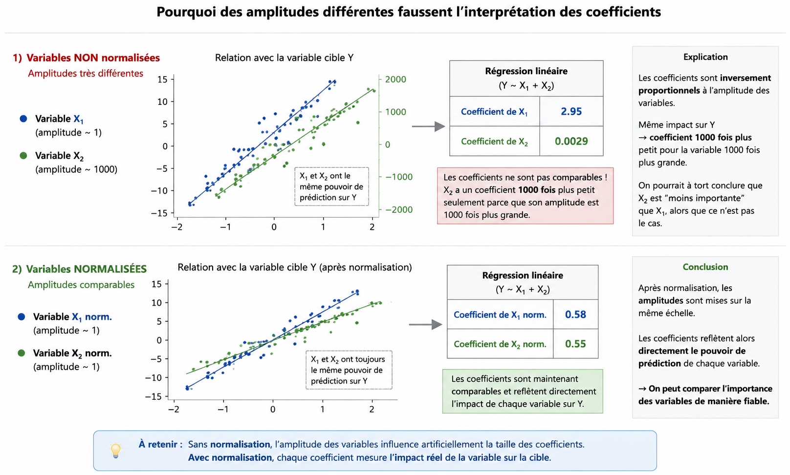
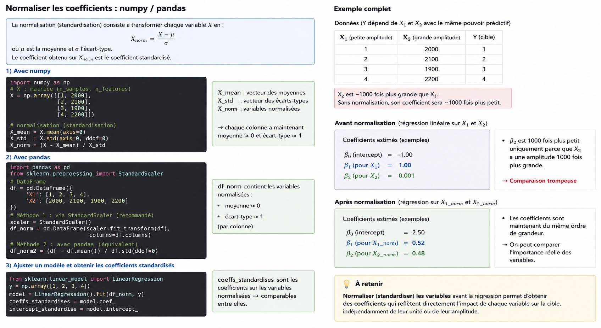

# Régression Linéaire

Cette méthode de prédiction supervisé permet de prédire des valeurs cibles ayant un rapport linéaire avec les variables (dont on peu définir une droite).

Nous avons donc :

* 1 variable cible (la prédiction)

* 1 ou plusieurs variables prédicteur (les prédicteur)


**Principe**

Prenons cette distribution prix (cible) / surface (variable):



Il est assez facile de voir que le prix augmente avec la surface de façon linéaire. Nous pouvons donc utiliser ces 2 données dans un modèle de régression linéaire pour prédire le prix ou bien la surface (l'un par rapport à l'autre).

Nous pouvons obtenir une prédiction moyenne:



Mais contrairement en un simple rapport 1:1, le modèle peut utiliser plusieurs variables (plusieurs prédicteurs), par exemple: "nombre de pièce", "type d'habitation", "..." . Ainsi chaque variable possèdera un poids différent dans le calcule en fonction de leur importance. 


**Exemple**:

```
poids = a_1 * taille + b_1 * age
```

Ici `poids` est la variable à prédire et `taille` et `age` sont les prédicteurs

`a_1` et `b_1` sont les poids appliqué en fonction de du calcule du [MSE](MSE.md)

à cela s'ajoute le biais (point de départ de la droite) et le bruit (coefficient aléatoire ou inexpliquée des données)

```
poids = (a_1 * taille + b_1 * age + b) + ε
```

**Biais (b)**

- est dans la **prédiction du modèle**
- sert à ajuster la droite
- est **contrôlé et appris**

**Bruit (ε)**

- est dans la **réalité des données**
- représente ce que le modèle ne peut pas expliquer
- est **incontrôlable**


# Limitations

**Attention**: Une régression linéaire ne fonctionne que si les prédicteurs (variables) sont eux-mêmes linéaires, sinon la méthodes n'est pas adapté et il faudra opter pour un autre algorithme.

Supposons que nous ayons une relation quadratique entre la variable cible et un prédicteur *y*=*a*∗*x*2 + du bruit comme sur le graphe ci-dessous. On voit bien que la droite  de la régression linéaire n'explique en rien la relation entre le  prédicteur et la cible.



# Fiabilité

## Vérifier la linéarité

Comparons nos candidats dans des nuages de points



**Si:**

- une droite → bon candidat
- une courbe → relation non linéaire (transformations possibles)
- un nuage sans structure → peu utile

### Corrélation de Pearson

Elle mesure la force d’une relation linéaire :

- proche de **+1 / -1** → bon signal
- proche de **0** → faible intérêt linéaire

En Python :

```
df.corr(numeric_only=True)
```

Ou avec une variable :

```
from scipy.stats import pearsonr
pearsonr(X, y)
```

⚠️ Attention : corrélation ≠ causalité.

## Rapporter tous les prédicteurs à une même plage

**Des variations d'amplitude significative peuvent fausser l'importance des coefficients**

Une autre précaution utile concerne l'amplitude respective des variables.

Les valeurs des coefficients de la régression linéaire sont en effet  inversement proportionnelles à l'amplitude de la variable associée.

Si une variable est 1 000 fois plus grande en moyenne qu'une autre  variable, et si ces 2 variables ont le même pouvoir de prédiction sur la variable cible, alors le coefficient de la grande variable sera  1 000 fois plus petit que celui de la deuxième variable.

En normalisant les variables afin que leur amplitude soit comprise dans un intervalle comparable, chaque coefficient de la régression linéaire  reflète directement l'impact de la variable sur la variable cible, son  pouvoir de prédiction.



**Application avec python**



# Evaluation du modèle

Méthodes de scoring

Pourquoi utiliser plusieurs méthodes ? Parce qu’ils répondent à 3 questions différentes :

| métrique        | logique                   | question                                           |
| --------------- | ------------------------- | -------------------------------------------------- |
| [MAE](MAE.md)   | erreur typique            | “en moyenne, je me trompe de combien ?”            |
| [RMSE](RMSE.md) | erreurs graves            | “est-ce que j’ai de grosses erreurs dangereuses ?” |
| [R²](R2.md)     | qualité globale du modèle | “est-ce que mon modèle explique les données ?”     |


