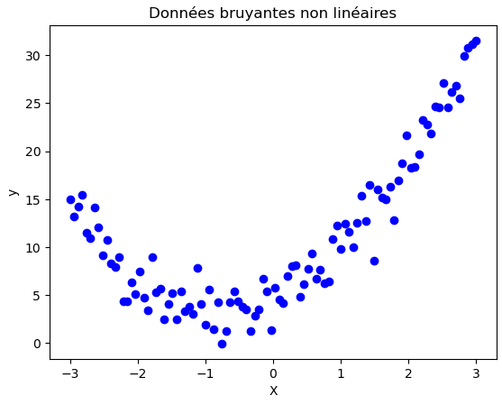
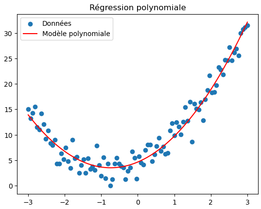
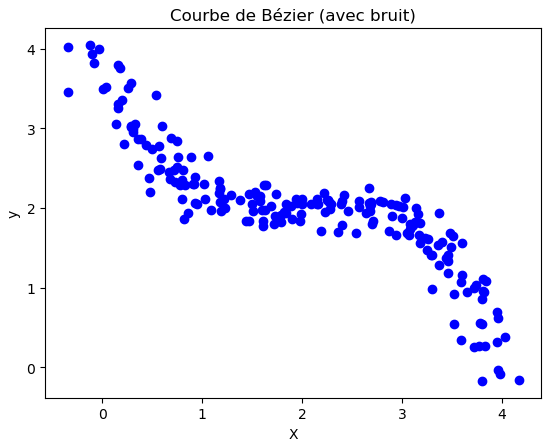
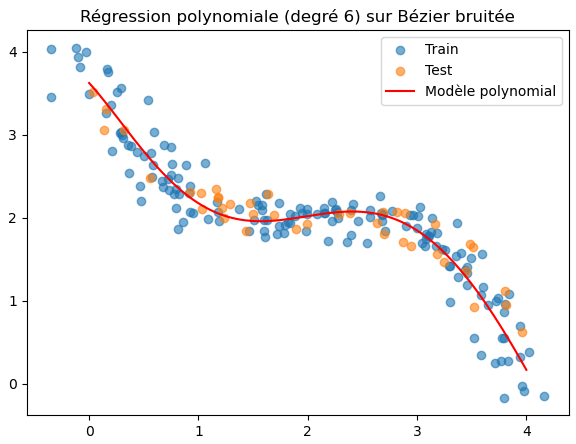
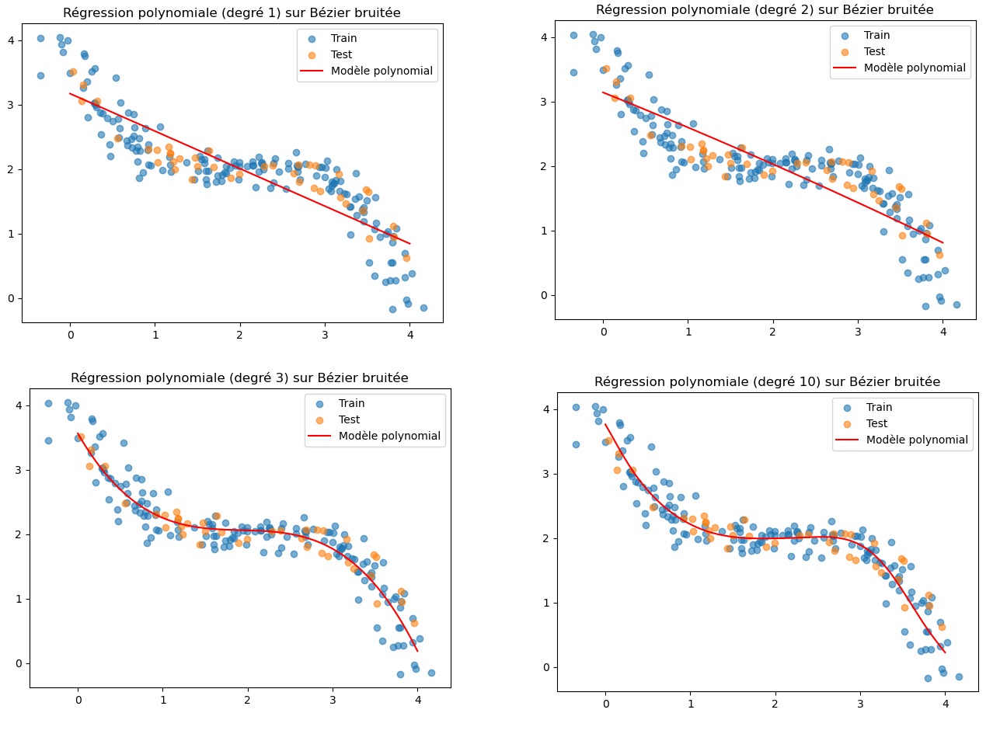

# Régression Polynomiale

Cette méthode de prédiction supervisé permet de prédire des valeurs cibles ayant un rapport courbé avec les variables (dont on peu définir une courbe).

Nous avons donc :

* 1 variable cible (la prédiction)

* 1 ou plusieurs variables prédicteur (les prédicteur)


**Principe**

Prenons cette distribution de relation quadratique avec du bruit:



Il est assez facile de voir que y varie de façon non-linéaire avec X mais suit tout de même une tendance.

Avec la régression polynomiale nous pouvons obtenir une prédiction moyenne:



Tout comme la régression linéaire le modèle peut utiliser plusieurs variables (plusieurs prédicteurs). Ainsi chaque variable possèdera un poids différent dans le calcule en fonction de leur importance. 


Une régression polynomiale est en réalité une **régression linéaire appliquée à des prédicteurs transformées**

On fait simplement :
$$
x \rightarrow [x, x^2, x^3, ...]
$$
Mais le modèle final reste une **Régression linéaire**, donc le type de prédiction est le même :
$$
\hat{y} = w_0 + w_1 x + w_2 x^2 + ...
$$


# Degré

Techniquement une régression polyminale pourra suivre la forme de n'importe quelle courbe mais dans certains cas cela produira des problèmes d'overfit si le degré est trop élevé.

Le **degré** en régression polynomiale correspond simplement au **niveau de complexité de la courbe que le modèle peut apprendre**.

Ici une courbe Bézier :





Il faudra tester plusieurs degrés lors de l'entrainement pour obtenir le meilleur résultat (généralement 3–6 selon cas):

```python
for d in [1, 2, 3, 5, 10]:
    poly = PolynomialFeatures(degree=d)
    X_train_poly = poly.fit_transform(X_train)
    X_test_poly = poly.transform(X_test)

    model = LinearRegression()
    model.fit(X_train_poly, y_train)

    y_pred = model.predict(X_test_poly)
    r2 = r2_score(y_test, y_pred)

    print(f"Degré {d} → R² = {r2:.3f}")
```

```
Degré 1 → R² = 0.704
Degré 2 → R² = 0.698
Degré 3 → R² = 0.889   <-- BEST
Degré 5 → R² = 0.858
Degré 10 → R² = 0.860
```



# Evaluation du modèle

Résultat : les erreurs sont comparables de la même façon que pour la régression linéaire.

Vous pouvez utiliser les méthodes de la régression linéaire pour évaluer le modèle :

| métrique        | logique                   | question                                           |
| --------------- | ------------------------- | -------------------------------------------------- |
| [MAE](MAE.md)   | erreur typique            | “en moyenne, je me trompe de combien ?”            |
| [RMSE](RMSE.md) | erreurs graves            | “est-ce que j’ai de grosses erreurs dangereuses ?” |
| [R²](R2.md)     | qualité globale du modèle | “est-ce que mon modèle explique les données ?”     |


