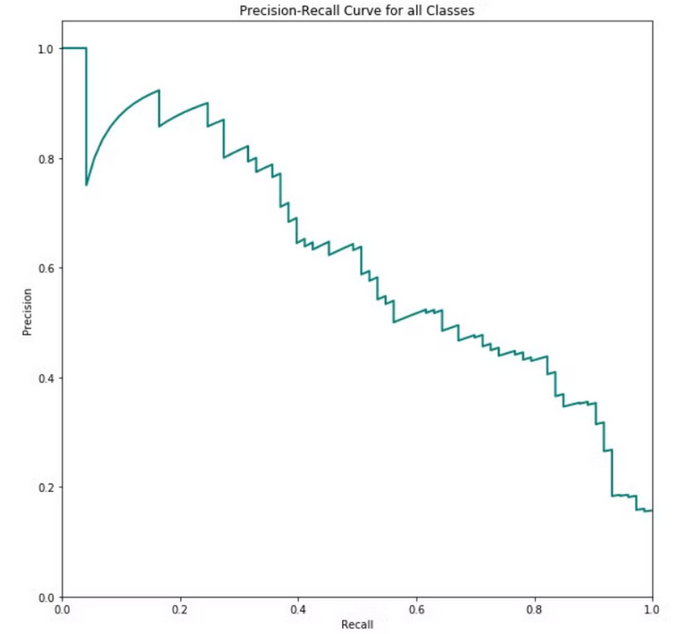

# Précision / Rappel

Une **courbe  (Precision–Recall curve)** est un outil utilisé en **classification** pour analyser comment un modèle se comporte quand on change le **seuil de décision**.

Un modèle de classification donne un **score de probabilité**:

- 0.90 : très probable positif
- 0.40 : douteux
- 0.10 : négatif

Ensuite on choisit un **seuil** (threshold) :

- si score > seuil = classe positive
- sinon = classe négative

La courbe représente le compromis entre **précision et rappel** en fonction du seuil :

- augmenter le seuil : ↑ précision, ↓ rappel
- baisser le seuil : ↑ rappel, ↓ précision

# Rappels

**Précision** = Parmi les éléments prédits positifs, combien sont corrects ?

**Rappel** = Parmi les vrais positifs, combien ont été détectés ?

# Exemple

Voici un exemple de courbe:

